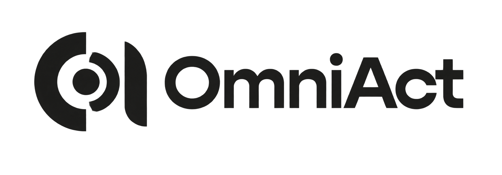

<p align="center">
  
</p>

<p align="center">
  <strong>One agent. Every digital environment.</strong><br>
  A lightweight general-purpose action agent for real digital work.
</p>

<p align="center">
  <strong>English</strong> · <a href="README.md">简体中文</a>
</p>

<p align="center">
  OmniAct helps users complete work across browsers, desktop applications, and CLI tools through one coordinated agent.
</p>

<p align="center">
  <a href="LICENSE"></a>
  
  
</p>

## Why OmniAct

Many agents are strong in one environment: coding agents work in repositories, browser agents work on web pages, and desktop agents work inside applications. Real digital tasks often cross all of them.

OmniAct is designed around that boundary:

- **One goal, multiple environments.** TeamLeader decides whether to reason directly or delegate work to a specialized Worker.
- **Specialized execution.** Browser, CLI, and Desktop Workers keep the observation and action loops suited to their environments.
- **Real deliverables.** Workers hand off Markdown summaries and concrete artifacts instead of only returning “done”.
- **Tasks can continue.** Parallel subtasks, human takeover, resumable CLI sessions, and execution traces support longer workflows.
- **A lightweight core.** Collaboration stays direct and clear while execution engines can evolve independently.

## How It Works

```text
User goal
   |
   v
TeamLeader
   |
   +-- Browser Worker  -> browser observations and artifacts
   +-- CLI Worker      -> Codex sessions and file artifacts
   +-- Desktop Worker  -> Windows application actions and artifacts
   |
   v
Task result, execution trace, and final deliverables
```

TeamLeader owns the overall task and delegates clearly bounded subtasks. Each Worker owns its execution environment and writes handoff information to the task directory. Workers do not need to share internal state or depend directly on one another.

The task directory keeps collaboration transparent and inspectable:

```text
tasks/<task-id>/
├─ task.md
├─ trace.jsonl
├─ trajectory.md
├─ workers/
│  └─ <worker-name>/
│     ├─ request.md
│     ├─ result.md
│     └─ artifacts/
└─ final/
   └─ result.md
```

## Quick Start

### Requirements

- Windows with Microsoft Edge installed
- Conda or another Python environment manager
- Python 3.11
- An OpenAI-compatible endpoint with tool-calling support for TeamLeader
- An OpenAI-compatible endpoint with vision support for Browser Worker
- Codex CLI installed when using CLI Worker

### Installation

```powershell
conda create -n omniact python=3.11
conda activate omniact
python -m pip install -r requirements.txt
Copy-Item .env.example .env
```

### Configuration

Fill in the model service settings in `.env`:

```dotenv
TEAM_LEADER_API_KEY=
TEAM_LEADER_BASE_URL=
TEAM_LEADER_MODEL=

BROWSER_WORKER_API_KEY=
BROWSER_WORKER_BASE_URL=
BROWSER_WORKER_MODEL=
BROWSER_WORKER_SESSION_MODE=inherited

# Optional: Windows Desktop Worker
DESKTOP_WORKER_ENABLED=false
DESKTOP_WORKER_API_KEY=
DESKTOP_WORKER_BASE_URL=
DESKTOP_WORKER_MODEL=
DESKTOP_WORKER_MAX_STEPS=50

# Optional: Codex CLI Worker
CLI_WORKER_ENABLED=false
CODEX_EXECUTABLE=codex.cmd
CODEX_SANDBOX=workspace-write
CLI_WORKER_WORKING_DIRECTORY=
CLI_WORKER_MAX_TURNS=3
```

`BROWSER_WORKER_SESSION_MODE` supports `inherited` and `clean`. `inherited` copies the current Edge profile into an isolated Worker browser so login state can be reused without taking over the browser window currently used by the user.

### Run

From the project root:

```powershell
python examples\run_team_leader.py
```

When a Worker pauses for human takeover, the example program supports:

```text
takeover <worker-id>
resume <worker-id>
cancel <worker-id>
```

Artifacts are written to `tasks/<task-id>/`, including the task description, Worker requests and results, screenshots, file artifacts, and a readable execution trace.

## Verification

```powershell
python -m compileall -q src tests examples
python -B -m unittest discover -s tests -v
```

## Roadmap

- Use benchmarks to improve Browser Worker and Desktop Worker
- Improve human takeover and recovery after partial failures
- Support scheduled recurring digital work
- Provide a local task console for submitting tasks and viewing artifacts
- Introduce more execution engines and reusable Skills

## Open Source

OmniAct is under active development. The public repository keeps its runtime core focused on task orchestration, Worker boundaries, task artifacts, and readable execution traces; a larger product interface will be added as the execution workflow stabilizes.

The project includes modified open-source components. See [THIRD_PARTY_NOTICES.md](THIRD_PARTY_NOTICES.md) for attribution and license information.

## License

OmniAct is released under the [MIT License](LICENSE).
