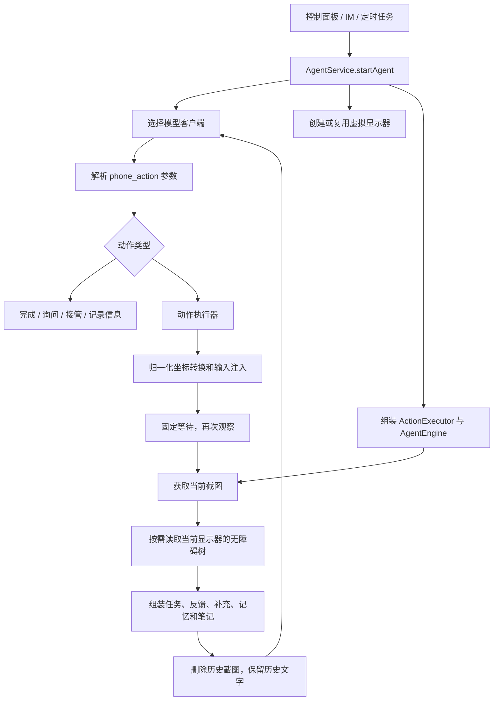

# GUI 感知与定位：当前链路、问题假设与优化方向

> 代码分析日期：2026-10-17。本文是研究与实验设计文档，不代表已完成性能诊断或选定实现方案。  
> 范围：GUI Agent 的观察获取、上下文组织、界面理解、目标定位及动作后的观察反馈。  
> 论文范围：30 篇纳入文献，其中 2025—2026 主样本 25 篇、2024 背景 5 篇；重点分析 11 篇（9 篇全文细读、2 篇重点章节阅读）。  
> 本文第 7 节收录完整论文调研。另保留[独立调研版](2025-2026-GUI感知与上下文-论文调研.md)，便于后续更新。

## 1. 研究目标与证据边界

目标是让 Agent 在每一步获得足以支持正确判断、且成本合理的信息，再提高它对页面、目标元素及操作位置的理解能力。不能把增加截图、增加树节点、增加模型数量或者压缩 token 本身当作最终目标。

本文区分三种证据：

- **代码事实**：可以直接从当前代码确认的实现行为。
- **问题假设**：根据实现推理出的潜在瓶颈，尚没有本项目失败分布或对照实验支持。
- **外部证据**：论文在其数据集、模型和评测协议下观察到的现象，不自动代表本项目也会获益。

本次仅静态阅读代码、在线研究和编写文档，没有运行应用、调用本项目模型服务或开展性能实验。因此不能给出当前定位准确率、主要失败原因比例、实际视觉 token 数及某项改动的收益百分比。

目前最有依据的研究起点是：先用少量真实材料定位失败类型，再比较任务相关上下文和按需局部观察。图树关系、历史关键事实与观察时机是可独立验证的方向；是否需要专用 grounder 或训练，取决于这些对照后的结果。第 3 节列完整假设，第 4 节给验证设计，第 5 节给论文对应与方向取舍。

## 2. 当前真实调用链

### 2.1 从任务入口到操作闭环



代码入口：`AgentService.kt:330`、`AgentService.kt:409`、`AgentService.kt:421`；循环位于 `engine\AgentEngine.kt:190`。

当前正常任务路径始终创建或复用虚拟显示器，创建参数来自设备 `displayMetrics`（`AgentService.kt:391`）。`VirtualDisplayManager` 中仍有 540×1170 的默认参数，但不能据此认定当前所有任务都在该分辨率运行。引擎保留物理屏幕分支，正常服务装配路径传入虚拟显示器。

### 2.2 截图如何产生

| 路径 | 实际处理 | 对研究的含义 |
|---|---|---|
| SystemBackend、本地 VD | `captureViaImageReader()` 读取本地帧；`ImageUtil` 等比例缩放到宽度不超过 768，JPEG 质量 85 | 模型不一定看到原始分辨率；小字和密集图标是否受影响要测 |
| RemoteBackend、远程 VD | `ScreenCapture` 请求 `captureScreen(displayId, 540, 85)` | 与本地路径的图像规格不同，对模型比较时要记录后端 |
| 远程镜像源 | 优先使用 `cachedMirrorFrame`；镜像 ImageReader 的宽高各为主 VD 的一半，先以 JPEG 质量 80 编码；需要时再缩放编码 | 可能存在多次有损处理；提高最终输出宽度不等于恢复源图细节 |
| 远程主 VD | 镜像缓存为空时尝试主 ImageReader；没有新帧时可以使用上次缓存 | 复用静态帧是合理工程机制，但返回数据没有携带帧生成时间 |
| 其他后端截图 | ImageReader 不可用时由 `CaptureOps` 提供其他截图路径 | 应记录实际来源，不能把所有截图质量与延迟归因于同一条路径 |

证据：`capture\ScreenCapture.kt:40`、`capture\ImageUtil.kt`、`engine\AgentEngine.kt:713`、`backend\PrivilegedService.kt:106`、`:414`、`:429`。

需要特别澄清：代码的部分注释或旧文档提到镜像编码有 500ms 节流，但当前阅读到的 `createMirrorVd()` 监听器是在获得帧后直接转换和编码，未见该节流条件。本文按实际实现分析，不把旧注释当作事实。

当前返回值主要是 JPEG 字节或 Base64 字符串；模型输入中没有显式记录截图来源、生成时间、读取时间、实际尺寸以及是否来自缓存。**这说明缺少诊断信息，不说明当前已经在使用错误旧帧。** 静态页面即使帧时间较早也可以完全有效，需要结合动作发生时间和页面变化判断。

### 2.3 界面树如何产生、筛选和表达

`AgentService` 将 `VdAccessibilityService.captureViewTree(displayId, width, height)` 作为回调传给引擎。截图完成后，引擎再单独读取树；它们不是有共同版本标识的一份观察记录。

树读取与遍历策略：

- 读取目标 display 的窗口；相关 API 失败时可以回退到 `windows`。正常路径尝试指定显示器，回退路径是否仍对应目标屏幕需要设备验证。
- 跳过包名为 `com.android.systemui` 的窗口，使用按需查询，`onAccessibilityEvent()` 当前没有用于观察调度。
- 深度上限 15，节点计数上限 200；深度优先遍历，先过滤不可见节点。
- 没有内容、不可交互的叶子节点跳过；有子节点的容器仍可能计入预算，即使该容器最后不输出一行。
- `text` 与 `contentDescription` 各取前 50 个字符。
- 输出短类名、文字、描述、可点击/编辑/滚动/勾选状态和 0—1000 坐标框；缩进保留部分层级信息。
- 未输出本步元素编号、resource-id、显式父子关系、窗口来源、可用状态/焦点等更丰富信息；也未按当前任务筛选节点。

证据：`accessibility\VdAccessibilityService.kt:14`、`:64`、`:79`、`:120`。

示意输出，不是某次真实采集：

```text
TextView "商品名称" (50,200)-(700,260)
Button "加入购物车" clickable (600,850)-(950,940)
```

这已经比纯截图提供了额外文字和坐标信息，不能把当前工程描述成没有结构信息的纯视觉 Agent。但它也没有独立的元素候选生成、视觉与树节点关联、目标候选排序或局部精定位模块。

### 2.4 模型每一步实际看到什么

`buildUserMessage()` 将一张当前截图放在前面，后面是一段文字。文字顺序大致为：

```text
系统执行反馈（如果有）
用户对追问的回答（如果有）
原始任务指令（第一步额外包含 VD 可能为空的提示）
当前 UI 元素列表（如果能获取）
本轮新到的用户补充（如果有）
所有启用的全局记忆（如果有）
当前任务笔记（如果有）
```

实际是带标题的字符串拼接，并非独立的类型化观察对象；“执行反馈”的前缀仍位于 user 消息中。消息外还有 system prompt、以前的 user 文字及 assistant 的动作 JSON。

| 信息 | 当前处理 | 已有能力与边界 |
|---|---|---|
| 任务 | 每步重发原始指令 | 目标持续可见；没有单独维护更新后的任务约束与完成进度 |
| 当前图像 | 每步一张 JPEG | 提供当前视觉证据；没有局部放大或主动请求详细观察的动作 |
| 界面树 | 每步附完整筛选结果 | 能提供精确文字和坐标；没有任务相关选择与变化摘要 |
| 历史图像 | `stripImagesFromHistory()` 删除所有旧图 | 节省成本；历史视觉证据只剩模型曾经写出的文字与旧树 |
| 历史文字 | 保留旧任务、旧树、旧记忆、旧 notes 和 assistant JSON | 保留过程信息，也重复保存每步大段观察 |
| 用户补充 | 队列在下一步被取出并附加一次 | 保留在消息历史中，但没有汇入持续维护的约束表 |
| 全局记忆 | 每步读取全部启用条目，按更新时间排序 | 已有长期信息；没有按任务或当前应用检索和预算控制 |
| 任务笔记 | 最多 10 个键，满时淘汰最早插入的键 | 提供跨页面临时记忆；不是自动提取的状态或证据索引，单条长度也没有这里的限制 |
| 执行反馈 | 执行失败、列表查询、重复动作、页面不变等写回下一步 | 已有恢复信号；不是每个成功动作的显式语义效果摘要 |

证据：`engine\AgentEngine.kt:375`、`:436`、`:524`、`:647`、`:882`、`:935`；`db\GlobalMemoryRepository.kt`、`db\GlobalMemoryDao.kt`。

一个重要细节：历史裁剪阈值是 **100 条消息，不是 100 步或 token 预算**。裁剪位于常规动作分支末尾；`ask_user`、`handoff_user`、`note`、`remember` 等提前 `continue` 的分支不会在该位置裁剪。因此不能描述成每次请求都有严格的 100 条上限，也不能假定历史始终以完整的“观察—动作”对保留。

另外，assistant 的动作 JSON 在动作真正执行前就加入历史，之后动作也可能被重复动作检查阻止或执行失败。下一步虽会收到失败反馈，但历史中的“模型提出了什么”与“设备实际执行了什么”没有在统一步骤对象里明确关联。上下文改造应保留这一区别，避免将模型动作意图当成设备状态变化的证据。

### 2.5 目标定位与坐标执行

当前由同一个模型同时完成页面理解、下一步选择和点击坐标预测。系统提示明确让模型优先使用树中 bbox 的中心点；工具的 `x/y` 是 0—1000 归一化整数。

```text
截图 / UI 元素列表 + 任务
  → 模型输出 tap(x,y)
  → Action.fromMap
  → ActionExecutor
  → InputInjector
  → CoordinateMapper.normalizedToPixel
  → PrivilegeBackend 注入目标 display
```

`CoordinateMapper` 已实现固定显示尺寸、旋转和边界坐标映射，不能在没有证据时认定坐标换算错误。图像等比例缩放通常不改变归一化位置；**缩图造成的识别精度下降，与坐标换算错误是两种问题**。

现有动作只输出点，没有目标元素编号、候选 bbox、目标描述到最终点击点的显式对应。若引入裁剪图，必须补充裁剪坐标到完整 VD 的变换；不能把局部图的 0—1000 坐标直接送给现有执行器。

执行层的 `success` 主要表示注入、启动等动作是否成功返回。例如点击成功返回不代表点到了正确按钮，更不代表任务目标已满足。

证据：`engine\LlmPrompts.kt`、`llm\ToolSchema.kt`、`action\ActionExecutor.kt:50`、`input\InputInjector.kt:181`、`input\CoordinateMapper.kt:74`。

### 2.6 动作后反馈与完成判定

- 常规动作后等待：`open_app` 2000ms，其他常规动作 1000ms；`wait` 动作自身还等待 2000ms。
- 下一步重新截图与读树；树字符串不变和画面相似检测可产生反馈。
- `ActionRepeatGuard` 已对部分重复行为产生反馈，不需要再从零造一个相同模块。
- 这些检测能发现“没变化”，不能直接判断“发生了正确变化”。列表滚动、商品数量修改、焦点移动的成功判据不同。
- `finish` 来自模型判断，工程直接进入完成处理；提示词虽要求先验证，但没有独立的、针对任务结果的完整验证模块。

证据：`engine\AgentEngine.kt:342`、`:647`、`:672`，`engine\ActionRepeatGuard.kt`。

### 2.7 模型客户端与现有可观测性

三个客户端在发送前转换同一份内部消息：通用客户端保留多模态内容列表，Anthropic 将 system 提取到顶层并转换图像块，Ollama 分离文字与 images。本文只说明本地代码转换行为，不推断远端各模型实际如何缩放图片或计算视觉 token。

后续如果引入多张 ROI，必须检查“图像—文字说明”的对应能否在三种转换后保持。尤其 Ollama 当前会把 textParts 合并、images 分离，不能假定原始图文交错顺序仍被完整表达。客户端序列化成功也不等于目标模型可靠支持多图比较。

已有 `StepResult`、logcat 的 capture/encode/llm/action 时间日志、debug 截图、聊天历史、FakeLlmClient 和 Python E2E 框架，可复用来开展评测。但是 `StepResult` 没有完整保存本步观察、最终输入、目标候选与动作后的语义结果。现有时间字段也不足以自动分离树采集、记忆读取、网络等待和重试的各自耗时。

现有镜像截图 E2E 主要验证创建与截图路径日志，不能单凭“使用镜像缓存”的日志证明图像内容一定是动作后的新状态。应在需要研究新鲜度时加入有已知可见变化的场景与内容检查。

`tests\e2e\mock_llm_server.py` 的内部 `RequestRecord.body` 已保存模拟请求体，公开 `get_request_log()` 当前只返回元数据；`FakeLlmClient.requestHistory` 也能保留内部消息快照。这些可以用于后续核对“最终到底发送了哪些内容”，无需一开始另建整套采集系统。它们覆盖模拟路径，真实客户端的请求与图像处理仍需单独确认。

## 3. 可能优化点：假设、机制与验证

下表是研究议题，不是已确认缺陷列表。优先级指先测什么，实际实施顺序仍取决于基线。

| 编号 | 代码事实与问题假设 | 可考虑的方法 | 需要先回答的问题 |
|---|---|---|---|
| H1 图像细节 | 本地/远程压缩规格不同；小字或小图标可能不可辨 | 全局图保留布局，必要时补充原始源的高分辨率区域；任务相关分辨率 | 错误是否集中在缩放后目标像素面积较小的页面？更高分辨率是否真能纠正？ |
| H2 图树时效 | 截图和树分开采集，无共同观察版本；缓存无时间元数据 | 带时间与来源的观察记录，动作后等待可用状态，有限重采样 | 动画/加载期存在多少图树不一致？错误帧与真实失败是否相关？ |
| H3 树预算 | DFS、固定 200 计数/15 深度/50 字符截断，未按任务选择 | 去除冗余容器、保留目标候选及其语义邻居；长文本按相关性展开 | 目标是否在原始树里却被当前筛选丢掉？缺树页面占比多少？ |
| H4 多模态关联 | 图与树同时存在，靠模型隐式对应 | 元素候选表、显式关系、必要时编号可视标注；冲突时补看 | 错误来自缺文字、同名元素歧义，还是 bbox 对应错误？标注会不会遮挡内容？ |
| H5 历史失衡 | 删旧图但保留冗长旧文字 | 最近少量动作结果 + 关键状态摘要 + 按需保留关键帧 | 哪些任务需要视觉历史？选择性保留是否比全部删图更有效且成本可控？ |
| H6 记忆相关性 | 全部启用记忆每步重复，notes 有简单容量限制 | 按任务/应用选择记忆，保留原始来源并维护当前任务事实 | 当前真实记忆规模是否足以产生干扰？简单筛选是否已经够用？ |
| H7 纠正与约束 | 补充只附加一次，原始任务每步重复 | 持续维护当前有效约束、已完成项和未决问题 | 长任务是否忘记早期纠正？摘要是否会错误覆盖原始要求？ |
| H8 定位分工 | 同一模型同时决策与输出坐标 | 决策保留语义目标，候选匹配或专用 grounder 定位；按需二次精定位 | 已知目标描述时定位准确率如何？额外调用的收益能否抵消延迟？ |
| H9 效果反馈 | 注入返回值与目标达成不同，当前反馈偏失败/未变化 | 针对上一动作的预期变化与观察差异，结果标记为已确认/未知 | 增加反馈是否减少无效步骤？是否只是重复让模型解释截图？ |
| H10 观察工具 | 只能每步接收既定单图，不能单独放大或展开树 | 低成本主动观察：crop、读局部文字、展开候选、重新观察 | 能否识别何时需要补看？误触发与额外耗时是否可接受？ |
| H11 输入预算 | 按消息数裁剪，缺少按各来源的可解释预算 | 分配任务、当前观察、历史、记忆预算；优先保留决定动作的证据 | 更紧预算是否损失目标召回？在哪些任务长度开始产生收益？ |
| H12 诊断归因 | E2E结果不能区分目标理解、候选丢失、点偏或等待不足 | 分层离线评测 + 在线任务回放与人工归因 | 能否在选模型前识别工程观察链路问题？ |

### 3.1 图像优化不能只改一个 maxWidth

应先区分以下三类情况：

1. 源图里就没有目标细节：需要改截图来源或获取方式，放大已压缩图不会凭空补回文字。
2. 源图清晰，但统一缩放使目标不可读：可比较更高全局分辨率与全局图加局部图。
3. 细节清楚，但同屏对象很多或目标语义不明确：增加分辨率可能无效，应研究候选筛选、目标描述及关系信息。

远程镜像本身半分辨率，所以 ROI 方案必须明确从哪一份源图截取、VIEW 模式能否获得同样的高质量来源，以及其成本。不能把在本地后端可用的方法直接视为远程后端同等可用。

若局部区域在完整源图中的像素框为 `(x0,y0,x1,y1)`，模型在该局部图上输出归一化坐标 `(u,v)`，则可先还原完整图像素：`x=x0+(u/1000)*(x1-x0)`、`y=y0+(v/1000)*(y1-y0)`，再按完整图宽高归一化到当前执行器的坐标系。这是未加边框、未旋转的简单裁剪情形；若图像预处理改变有效区域位置，需要记录相应变换。关键是让坐标来源可追踪，而不是先假定当前映射有错。

### 3.2 树优化不能只减少节点数

当前有价值的信息可能存在于不可点击的标签、某个可点击父容器或列表项的相邻价格/名称中。仅保留 clickable 容易丢掉“这是谁的按钮”。建议比较：

- 原始可见树、当前规则树与任务相关候选树的目标召回。
- 保留候选本身与保留候选加父级/相邻标签的差异。
- 文本完整度、可交互状态、位置关系对同名元素区分的贡献。
- 无障碍树不可用或覆盖不足时，视觉路径的能力。

可以考虑页面内元素编号，但编号首先是当前观察的引用，不代表跨页面持久身份。编号化表格与在截图上画框是两个独立实验，应分别评估。

### 3.3 上下文优化的关键是保留有效证据

可研究的组织方式：

```text
任务：原始请求 + 当前有效补充约束
进度：已确认事实、未完成目标、未决问题
当前观察：全局图 + 必要局部图 + 相关元素/关系
最近动作：执行了什么、观察到什么、哪些结果未知
历史证据：与当前判断有关的少量关键页面或事实
相关记忆：只包含本任务需要的稳定信息
```

这只是表达目标，不是要求照着建立六个复杂子系统。应先比较简单的确定性组织，再考虑模型生成摘要或学习式选择。摘要有自己的遗漏与错误成本，不能把摘要当作真实观察；临时事实应尽量附来源步骤，必要时回看原文或图像。

### 3.4 定位优化要拆开“找哪个”与“点哪里”

可把一次误操作分为：

- 任务理解或下一步选择错误。
- 选对动作但选错对象，例如点了另一件商品的“购买”。
- 对象选对，但坐标不在有效可点击区域。
- 对象和坐标正确，但观察到执行之间界面发生变化。
- 点击已生效，但后续读取过早或结果解释错误。

专用 grounder 主要针对中间两项，不会自动修复任务理解与时序问题。将语义目标写成“第二行、某商品卡片内的加入购物车按钮”也需要上游提供足够上下文，不能默认增加一个模型就完成了模块解耦。

### 3.5 用具体任务理解优化点

以下为推演样例，并非已观测到的项目失败记录。

**样例一：商品列表里有多个“购买”。** 原始任务是购买某种规格、某个价位的商品。仅提供所有按钮文字和坐标会让模型自行关联商品标题、规格、价格与按钮。可能的改进是保留商品卡片的局部关系，先确定正确卡片，再在卡片内定位。应验证的重点是选错对象比例，而非只测坐标偏移；全局图、关系表和局部图哪个有效需要比较。

**样例二：跨应用比较价格。** 第一个应用的页面离开后，旧截图被移除；如果 notes 没记录型号或优惠条件，后续仅看动作 JSON 可能无法还原比较依据。可能的改进是保留带页面来源的关键事实，必要时保留一张关键帧。应检查型号、规格、优惠条件是否完整，而非只检查最终回答里有没有两个价格。

**样例三：点击搜索后出现加载动画。** 固定等待后截图可能仍是加载页，树可能已经更新或尚未更新。可能的改进是观察动作相关变化、必要时再看一次。应测真实内容可用时间与额外等待成本；单纯每步延长等待会让本来很快的操作变慢。

这三个样例分别对应关系感知、历史证据和动态观察。它们说明不同问题可能需要不同方法，选择前要先找到本项目真正集中的失败类型。

## 4. 如何用证据决定优化顺序

### 4.1 第一层：离线观察与定位诊断

建议先整理一份覆盖真实使用场景的小规模材料集，不把它当作最终 benchmark。起步可用约 100—200 个页面、每页 1—3 个目标作为诊断规模，再根据错误分布扩充。数字是建议的起步工作量，不是统计充分性的保证。

材料应覆盖：中文小字、纯图标、同名按钮列表、输入法弹出、弹窗遮挡、滚动后对象变化、WebView/自绘页面、跨应用比价、用户补充约束，以及 system/standard、后台/VIEW 等实际路径。

每条材料至少包含任务、原始可用截图、实际发送截图、原始/筛选后的树、目标的语义说明、一个或多个有效点击区域、图像与显示坐标变换。若原始高分辨率源不可获得，应明确缺失，不能用放大低分辨率图替代“原始图”。

| 评测 | 隔离变量的方法 | 主要指标 |
|---|---|---|
| 观察信息是否足够 | 人工分别阅读当前输入、原始材料，判断能否确定目标 | 信息缺失比例及类型；目标在原始树/筛选树中的覆盖率 |
| 元素筛选是否合理 | 固定页面和目标，只换树筛选方式 | 目标召回率、相关关系保留率、节点数、文本长度 |
| 定位能力 | 给定明确目标描述，固定模型与页面 | 点落在有效区域的比例；错误对象比例；小目标分组表现 |
| 图像策略 | 固定任务/模型/树，比较当前规格、较高分辨率、ROI | 定位与读字表现、每请求成本、额外延迟 |
| 历史组织 | 固定当前观察与任务，只换历史输入 | 约束遵守、信息回忆、目标选择、输入长度 |

不能只报告坐标距离：落在较大 bbox 内不一定点到真实可点击区域；有多个合理位置时应允许多个有效区域。也不能只给模型目标 bbox 后测坐标，因为这绕过了真正的目标定位问题。

### 4.2 第二层：动态观察与动作效果

静态截图定位测不出加载、动画、焦点与键盘问题。需要受控地执行动作，记录动作时间、实际图像生成/读取时间、树采集时间和已知页面变化。

重点观察：固定等待是否过长或不足；同一显示器上的图树是否大体对应；新页面/新列表内容出现时是否仍读取上次状态。只记录必要信息，不为罕见情形建立庞大的恢复框架。

已有缓存不是应该一律清空的对象：静态 UI 复用帧可以省成本。研究的目标是确认一次观察是否足以判断上个动作的结果，而不是强制每步制造一张不同图片。

### 4.3 第三层：在线端到端任务

复用 `tests\e2e\framework.py`、场景定义、ADB 与现有断言。模拟模型适合验证通信、输入变换和 UI 流程，**不能用于证明真实模型的感知准确率提升**。

建议选取约 20—30 类任务起步，按定位、读字、列表区分、时序、历史依赖分组。对同一初始状态和同一模型进行配对比较；随机性明显时重复运行并报告样本数与不确定性，不从一次成功得出结论。

报告至少包含：

- 独立结果检查后的任务成功率，而不是仅统计 `finish`。
- 目标定位正确率、错误对象比例、有效动作比例和重复无效步骤。
- 总任务耗时、单步与额外观察延迟、模型调用次数。
- 文本输入量、图像尺寸与数量、服务实际提供时的 token 用量和费用；不同服务不强行用一个图像估算公式比较。
- 用户求助/接管次数及原因，后端、设备、屏幕尺寸与应用版本。

性能预算应由当前基线和用户可接受延迟决定，不在没有测量时规定“最多增加多少毫秒”。

### 4.4 避免混杂的最小对照顺序

| 实验 | 唯一主要变化 | 判断什么 |
|---|---|---|
| A0 | 保持现状并记录必要观察材料 | 建立基线与失败分布 |
| A1 | 当前截图 vs 更高可用质量截图，历史/树不变 | 图像细节是否是瓶颈 |
| A2 | 当前树 vs 任务相关候选与邻居，图像不变 | 树筛选是否能省成本且保持/提升目标召回 |
| A3 | 当前历史 vs 结构化近期结果与关键事实 | 历史组织是否改善长任务和纠正遵守 |
| A4 | 当前单图 vs 按需 ROI，使用同一模型 | 补看细节是否值得增加请求成本 |
| A5 | 当前统一预测 vs 语义目标加独立定位 | 定位分工是否有效，额外模型是否必要 |
| A6 | 最有效的单项组合，再检查相互作用 | 多项收益能否同时保留，而非简单相加 |

若 A1 无收益、A2 改善明显，应优先改结构化信息；若树缺失占主要比例，可转向视觉定位；若受控定位已经很好而动态任务差，应优先研究观察时序和反馈。研究方向应允许被实验推翻。

## 5. 论文证据与工程方向的初步对应

### 5.1 已交叉核验的方法与复用边界

下列论文由主线程进一步核对官方论文页或官方仓库，详细论文样本、阅读深度与方法分析见配套调研。

| 论文 | 外部证据 | 对应假设 | 在本项目中的取舍 |
|---|---|---|---|
| DiMo-GUI，EMNLP 2025 | 将文字与图标处理分开，并通过逐步缩小观察范围改善定位；推理时方法，无需额外训练。[正式论文](https://aclanthology.org/2025.emnlp-main.1334/)、[代码](https://github.com/vivo/DiMo-GUI) | H1/H4/H8/H10 | 可先借鉴局部观察与停止条件；仍需验证中文手机页面及额外推理成本 |
| RegionFocus，ICCV 2025 | 通过聚焦区域、局部候选与可视化位置记录研究视觉推理预算分配。[正式论文](https://openaccess.thecvf.com/content/ICCV2025/html/Luo_Visual_Test-time_Scaling_for_GUI_Agent_Grounding_ICCV_2025_paper.html) | H1/H5/H8/H10 | 适合启发困难步骤的补看；[仓库](https://github.com/tiangeluo/RegionFocus)公开 ScreenSpot-Pro 部分，明确未公开 WebVoyager 在线代码 |
| ShowUI，CVPR 2025 | 研究 UI 感知视觉 token 选择、视觉与动作历史的组织；有模型与代码。[官方仓库](https://github.com/showlab/ShowUI) | H3/H5/H11 | 可借鉴选择原则；模型内部视觉 token 筛选需要相应模型实现，当前 API 消息层只能做信息级筛选 |
| GUI-Actor，NeurIPS 2025 | 新增动作注意力头，将语义目标关联到视觉 patch 候选区域，并研究候选选择。[论文](https://arxiv.org/abs/2506.03143)、[官方代码](https://github.com/microsoft/GUI-Actor) | H4/H8 | 代表模型级定位路线；需匹配模型实现与权重，训练新增动作头也仍需要训练条件 |
| GUI-Eyes，AAAI 2026 | 以强化学习训练何时及如何调用裁剪/放大工具的主动感知策略。[正式论文](https://ojs.aaai.org/index.php/AAAI/article/view/40175) | H1/H8/H10 | “提供观察工具”可以先研究；重现论文策略需要训练条件，不能把增加 crop 工具视为复现其结果 |
| GUI-Lens，2026 预印本 | 将 OCR/组件位置作为参照，让模型选择下一次裁剪范围与尺度，最后映射回原屏坐标。[全文](https://arxiv.org/html/2608.03270v1) | H1/H3/H4/H8/H10 | 适合比较“先决定看哪块”与“围绕初始点击点放大”；借用现有树作为部分位置参照是工程推演，需要实测 |
| MemGUI-Agent，2026 预印本 | 同步维护折叠后的动作历史、UI 事实和近期步骤，研究上下文管理与动作联合输出。[官方仓库](https://github.com/kwai/MemGUI-Agent) | H5/H6/H7/H11 | 与当前删旧图留旧文字的策略高度相关；较小模型能否可靠遵守更新协议须验证，公开资源含数据处理、离线评测与训练模板 |
| UI-Hawk，EMNLP 2025 | 通过屏幕流数据和理解历史的视觉编码器研究手机交互时序理解。[正式论文](https://aclanthology.org/2025.emnlp-main.920/) | H5/H9 | 支持将历史视觉作为独立实验变量；其训练后的编码能力与向当前 API 多传几张图不同 |
| STAMP，2026 预印本 | 在可控虚拟环境中生成可验证的记忆依赖任务，用于训练显式记忆行为。[论文](https://arxiv.org/abs/2605.29324) | H5/H6/H7 | 可借鉴离开页面前记录关键事实的任务与评测设计；完整训练链路是后续研究投入 |
| ATMem，2026 预印本 | 将任务相关值与角色、使用状态关联，研究主动维护执行状态及成本感知的记忆使用训练。[论文](https://arxiv.org/abs/2606.31612) | H5/H7 | 可研究最小任务事实表与约束状态；不要把工程中的简化状态表等同于论文训练方法 |

这些证据支持研究“有选择地看、有关系地表达、有依据地保留历史”。它们没有证明本项目当前哪一环最差，且手机原生树、桌面高分辨率截图和网页评测的适用条件不同。

### 5.2 建议的分阶段收敛

**阶段一：先建立可比较的输入与诊断基线。**

先确认每条截图路径的实际尺寸、图像来源和图树对应；复用现有请求快照与 E2E 材料，选出一批能区分 H1—H12 的页面和任务。产出失败归因及输入组成统计。这里只做支撑当前研究的最小观察记录，不扩大为全项目轨迹平台建设。

**阶段二：优先比较两个可在现有模型调用周围实现的方向。**

1. **任务相关上下文**：候选元素保留语义邻居；近期动作附观察结果；任务补充持续可见；长期记忆只选择相关项。先与简单规则做比较，再判断是否需要额外模型或检索系统。
2. **全局观察加按需局部观察**：保持页面整体布局，对小字、重复对象、难定位目标补充局部证据；同时明确源图质量、裁剪映射及停止条件。与提高全局分辨率的简单基线比较。

这两个方向对应当前代码中明确存在的输入取舍，又有近期论文提供具体方法参照。这里的优先级表示值得优先做小实验，尚未确认应全部实施。

**阶段三：根据分层评测决定是否引入独立定位能力。**

如果给定正确语义目标后仍频繁点偏，再比较通用模型、树候选匹配和专用 grounder。若主要是找错对象，应先改目标上下文与关系表示；若主要是读到过渡状态，则优先改观察时机。部署专用模型需要同时评估服务接口、显存、请求延迟和维护成本。

**阶段四：有足够数据后再研究学习式感知与记忆。**

GUI-Eyes、STAMP、ATMem 等方法为主动观察策略和记忆行为训练提供研究线索。只有当低成本对照已经定位出持续存在的问题、训练数据与评测可用时，再考虑重现或迁移。训练本身不是本轮默认交付。

### 5.3 当前最值得回答的三个研究问题

1. **在相同调用预算下，任务相关元素与近期状态是否比当前完整旧文字历史更有用？** 主要看目标召回、约束遵守和任务成功，同时计入筛选成本。
2. **对于中文手机页面，什么时候局部高质量观察值得额外一次推理？** 按文字大小、目标密度、无障碍覆盖和后端分别分析，比较单张更清晰全局图。
3. **实际错误主要来自目标理解、对象关联、点位预测还是观察时序？** 先归因，再决定 grounder、关系表示或动态等待哪一个值得投入。

论文证据表与重点阅读记录见配套调研；上述优先级综合了代码适配范围、外部方法证据和验证成本，属于研究优先级，尚非经本项目实验确认的实施优先级。

## 6. 源码阅读索引与交付检查

以下路径相对于 `android\app\src\main\java\ai\opencyvis\`，行号对应本次阅读的代码：

| 文件 | 阅读重点 |
|---|---|
| `AgentService.kt:330` | 正常任务装配、模型选择、VD创建和树回调 |
| `engine\AgentEngine.kt:190` | 完整观察—决策—执行闭环 |
| `engine\AgentEngine.kt:882` | 当前输入字符串与图像组织 |
| `engine\AgentEngine.kt:935` | 历史图像删除 |
| `engine\LlmPrompts.kt` | 坐标、bbox 使用方式和任务规则 |
| `accessibility\VdAccessibilityService.kt:120` | 树预算、过滤与输出 |
| `capture\ScreenCapture.kt`、`capture\ImageUtil.kt` | 截图规格与编码 |
| `display\VirtualDisplayManager.kt:226` | 本地采集、Surface 切换与缓存 |
| `backend\PrivilegedService.kt:106` | 远程帧优先级与缓存 |
| `backend\PrivilegedService.kt:410` | 镜像源尺寸和编码 |
| `action\ActionExecutor.kt:50` | 动作语义与返回值 |
| `input\CoordinateMapper.kt:74` | 坐标映射 |
| `engine\ActionRepeatGuard.kt` | 已有重复动作反馈，避免重复建设 |
| `db\GlobalMemoryRepository.kt`、`db\GlobalMemoryDao.kt` | 记忆查询与更新 |
| `llm\LLMClient.kt`、`AnthropicClient.kt`、`OllamaClient.kt` | 输入序列化差异 |

其他已阅读材料：`docs\architecture.md`、`docs\components.md`、`docs\agent-optimization-roadmap.zh-CN.md`、`engine\AgentEngineTest.kt`、`fixtures\FakeLlmClient.kt`、`tests\e2e\framework.py`、`tests\e2e\assertions.py`、`tests\e2e\cases\test_mirror_vd_capture.py`、`tests\ui\scenarios.yml`。

本次没有改业务实现、安装依赖或运行构建/设备测试。最终检查限定为代码证据复核、论文来源核对和文档完整性检查。尚未验证的主要事项是各类假设在本项目中的出现频率、实际成本与收益，以及候选模型在目标设备/服务上的适配情况。

## 7. 完整论文调研附录

检索截止：2026-10-17。范围聚焦手机 GUI Agent 的感知与定位、截图和界面树互补、任务相关上下文筛选、跨步历史与记忆、动作后的观察，以及多尺度视觉定位。共整理 30 篇：按正式发表年份或预印本年份归类，2025–2026 年主样本 25 篇，2024 年背景 5 篇；其中 OS-Atlas、UGround、AndroidWorld 首发于 2024 年、正式发表于 2025 年。11 篇重点论文已访问全文 HTML/PDF 并阅读方法、实验或局限章节，其中 9 篇为 A 层、2 篇为 B 层；C 层仅核对元数据、摘要或仓库，不计入全文分析。

### 检索与证据口径

先阅读本机 paper-search-mcp 技能说明，并用其论文检索入口进行主题发现；2026-10-17 再用论文标题、作者和会议名做一手来源核对。主题词组包括 GUI grounding / visual grounding、mobile GUI agent / Android GUI agent、screen stream、accessibility tree、context management、agent memory、active perception、multi-scale crop / high-resolution grounding。随后通过作者或官方会议页面、ACL Anthology、CVF Open Access、NeurIPS/AAAI/ICLR proceedings、OpenReview、arXiv 作者稿和官方 GitHub 逐项核对题名、年份、发表状态与代码内容。仅把论文、会议论文集、作者项目页和作者仓库作为事实来源；社区论文列表仅作查漏线索，不作发表状态证据。

“已录用/正式发表”以论文集、会议官网或出版者记录为准；arXiv 论文单独标为预印本。若作者项目页宣称录用、但未能在会议论文集找到记录，会在表中注明其证据边界。代码状态按仓库实际可见内容描述，不把模型权重、评测脚本或基准代码称作完整 Agent 实现。“全文”指访问论文 HTML 或 PDF；A 层级表示阅读了方法、实验及限制/讨论章节，B 表示已读全文中与本主题相关的关键章节，C 表示仅核对元数据、摘要或仓库，不计入全文分析。检索日志按 8 组关键词归纳；表内 30 篇是人工去重后的纳入数，不是搜索原始命中数；各检索入口的原始命中未统一保存，故不报告搜索结果总量。

### 论文证据表

#### 2025–2026 主样本（25 篇）

| # | 论文与年份/会议状态 | 平台与主题 | 训练和推理成本 / 适用边界 | 代码与实际公开内容 | 阅读层级 |
|---:|---|---|---|---|---|
| 1 | [GUI-Eyes: Tool-Augmented Perception for Visual Grounding in GUI Agents](https://ojs.aaai.org/index.php/AAAI/article/view/40175)，AAAI 2026 正式论文 | 跨 Android、桌面、Web 的静态 grounding 基准；学习是否裁剪/缩放并进行两阶段定位 | Qwen2.5-VL-3B 上做 GRPO；文中使用 3,000 个标注样本、8×H100。在线主动裁剪可增加推理轮次；基准主要测 grounding，不能直接等同长程 Android 任务能力 | [官方论文页](https://ojs.aaai.org/index.php/AAAI/article/view/40175) 未见官方代码链接；截至检索日未找到作者官方实现仓库 | A：官方 PDF 全文，方法、训练设置、实验与结论 |
| 2 | [InfiGUI-G1: Advancing GUI Grounding with Adaptive Exploration Policy Optimization](https://ojs.aaai.org/index.php/AAAI/article/view/40500)，AAAI 2026 正式论文 | 跨平台 GUI grounding；多候选探索和语义对齐 | 3B/7B 模型经 RL 训练；AEPO 在单次输出中探索多个答案并用自适应奖励引导，需改模型并承担训练成本，不是 API 包装层的裁剪技巧 | [官方仓库](https://github.com/InfiXAI/InfiGUI-G1) 公开训练/评测目录、配置和脚本 | B：官方论文 PDF 摘要、方法与实验要点；仓库结构已核对 |
| 3 | [GUI-Lens: Coarse-to-Fine Cropping for GUI Grounding with General-Purpose VLMs](https://arxiv.org/abs/2608.03270)，2026 arXiv 预印本；未核实正式会议录用 | 桌面/Web/手机等 GUI grounding；OCR 与组件坐标提示、多轮自选区域裁剪、视觉核验 | 免训练推理包装流程；每轮都可能调用 VLM，精度收益与 API 延迟/费用交换。论文比较指出模型自选区域比围绕早期点击点反复放大更稳 | 论文提供[作者代码仓库链接](https://github.com/Fzkuji/GUI-Agent-Harness)，附录称其包含 grounding pipeline、基准适配器和配置；本次访问该链接返回 404，未验证代码实际公开可用 | A：arXiv HTML 全文；方法、消融、效率分析及实现附录 |
| 4 | [MemGUI-Agent: An End-to-End Long-Horizon Mobile GUI Agent with Proactive Context Management](https://arxiv.org/abs/2606.19926)，2026 arXiv 预印本；未核实正式会议录用 | Android 长程任务；ConAct 同步更新折叠历史、UI 事实记忆、最近步骤记录 | 原型在 235B 模型上可零样本使用上下文协议；小模型效果需要 MemGUI-3K 监督训练。论文显示只改提示格式并不保证小模型收益 | [官方仓库](https://github.com/kwai/MemGUI-Agent) 公开 MemGUI-3K 数据整理/评测脚本、LoRA SFT 模板和模型；仓库列出 8B 模型训练参数 | A：arXiv HTML 全文，协议、消融、误差类型、训练与限制 |
| 5 | [What Memory Do GUI Agents Really Need? From Passive Records to Active Task-Driving States](https://arxiv.org/abs/2606.31612)，2026 arXiv 预印本；论文称代码与模型将发布，检索时未找到官方仓库 | Android 多应用数据工作流；记忆条目显式标记 remaining / finished / skipped | SFT + STR-GRPO；作者报告 RL 使用 128 张 H20、约 3 天，资源门槛很高。条目状态减少重复/漏做，但论文仍报告提前终止和步数上限失败 | 未发现已公开的作者代码仓库；论文只承诺后续公开 | A：arXiv HTML 全文，状态结构、训练基础设施、实验和错误分析 |
| 6 | [STAMP: Training Explicit Memory for Mobile GUI Agents in Controllable and Scalable Virtual Environments](https://arxiv.org/abs/2605.29324)，2026 arXiv 预印本；未核实正式会议录用 | Android 长程任务；在可控虚拟环境监督何时记住、记什么、何时取回 | 虚拟任务合成 + SFT + 在线 RL；训练数据管线本身依赖多个强模型，作者指出工程与计算成本高。虚拟环境与真实应用的噪声、隐藏动态仍有差距 | 截至检索日未找到作者官方代码仓库 | A：arXiv HTML 全文，记忆监督、实验、消融和作者局限 |
| 7 | [AndroTMem: From Interaction Trajectories to Anchored Memory in Long-Horizon GUI Agents](https://arxiv.org/abs/2603.18429)，2026 arXiv 预印本 | Android 长程记忆诊断与评测；里程碑锚点与累积历史 | 主要贡献是诊断框架和 benchmark，而非可直接接入的感知模型；不同上下文机制对模型调用与历史长度有不同成本 | [官方仓库](https://github.com/CVC2233/AndroTMem) 已公开 AndroTMem-Bench 的推理与评测脚本；不能据此称完整 Agent 或训练代码均已开放 | C：核对摘要与仓库；未读全文关键章节 |
| 8 | [MemGUI-Bench: Benchmarking Memory of Mobile GUI Agents in Dynamic Environments](https://arxiv.org/abs/2602.06075)，2026 arXiv 预印本；作者仓库称已录用 ACM MM 2026，未以正式论文集页再次核对 | Android 记忆基准；跨时间、跨页面/应用的事实保持与任务完成 | 评测集和运行环境，非记忆算法；需 Android 模拟环境，在线评估有运行成本 | [官方仓库](https://github.com/lgy0404/MemGUI-Bench) 公开任务、容器/评测工具和轨迹；不是被测模型实现 | C：核对摘要、仓库及录用公告；未读全文关键章节 |
| 9 | [OS-Atlas: A Foundation Action Model for Generalist GUI Agents](https://arxiv.org/abs/2410.23218)，首发 2024，ICLR 2025 正式论文 | Android、桌面、Web；跨平台大规模 grounding 数据与统一动作建模 | 训练专用模型和数据管线；不是免训练接口改造。训练需要数据与算力；部署开销应按实际模型和硬件测量，不能与未测量的托管 API 直接比较 | [官方仓库](https://github.com/OS-Copilot/OS-Atlas) 公开数据/模型/训练与评估资源 | B：ICLR 官方论文全文 PDF 及 Android 结果部分 |
| 10 | [Navigating the Digital World as Humans Do: Universal Visual Grounding for GUI Agents（UGround）](https://proceedings.iclr.cc/paper_files/paper/2025/hash/4ca0e369689dadb25a5345ba9755ad6f-Abstract-Conference.html)，首发 2024，ICLR 2025 Oral 正式论文 | 手机、桌面、Web 的纯视觉 grounding；高分辨率截图定位 | 专用模型训练；论文数据规模约 10M UI 元素/1.3M 截图，主要贡献为模型与数据，不是零训练组件 | [官方仓库](https://github.com/OSU-NLP-Group/UGround) 提供模型、训练/评测与数据资源 | B：官方 ICLR 论文、项目页和仓库核查 |
| 11 | [ShowUI: One Vision-Language-Action Model for GUI Visual Agent](https://openaccess.thecvf.com/content/CVPR2025/html/Lin_ShowUI_One_Vision-Language-Action_Model_for_GUI_Visual_Agent_CVPR_2025_paper.html)，CVPR 2025 正式论文 | 跨平台 GUI VLA；论文加入 UI token selection 与视觉历史 | 2B 模型和训练数据方案；UI token selection 是模型内部视觉 token 选择机制，不能等同包装层对上下文字符串做截断 | [官方仓库](https://github.com/showlab/ShowUI) 公开模型/代码、训练评测和 demo | B：官方 CVF 论文页/PDF与仓库 |
| 12 | [GUI-Actor: Coordinate-Free Visual Grounding for GUI Agents](https://proceedings.neurips.cc/paper_files/paper/2025/hash/16130af940e9dabb43c726119bd3b42e-Abstract-Conference.html)，NeurIPS 2025 主会正式论文 | 桌面为主的 grounding；动作注意力头提出一个或多个区域，再由 verifier 选择 | 需模型内部新增 action head；论文报告冻结主干仅调约 100M 参数的 head 可训练，但依然需要模型微调，不能作为现有 API 的透明替换 | [官方仓库](https://github.com/microsoft/GUI-Actor) 含模型源码、训练/评测、verifier、数据与 demo | A：arXiv HTML 全文，方法、训练、结果及模型适用边界 |
| 13 | [Visual Test-time Scaling for GUI Agent Grounding (RegionFocus)](https://openaccess.thecvf.com/content/ICCV2025/html/Luo_Visual_Test-time_Scaling_for_GUI_Agent_Grounding_ICCV_2025_paper.html)，ICCV 2025 正式论文 | 桌面专业软件与网页；失败后由视觉反馈触发区域聚焦/再次观察 | 免额外训练但使用多轮模型调用；在 ScreenSpot-Pro、WebVoyager 上报告提升，测试基准覆盖并不等于手机任务验证 | [官方仓库](https://github.com/tiangeluo/RegionFocus)：ScreenSpot-Pro 定位评测代码公开；WebVoyager 在线相关代码因公司政策未公开。不可描述为完整系统全部开源 | A：CVF 官方论文全文 PDF，方法、实验及代码边界 |
| 14 | [Iris: Breaking GUI Complexity with Adaptive Focus and Self-Refining](https://openaccess.thecvf.com/content/ICCV2025/html/Ge_Iris_Breaking_GUI_Complexity_with_Adaptive_Focus_and_Self-Refining_ICCV_2025_paper.html)，ICCV 2025 正式论文 | 高分辨率 GUI；依据图像边缘密度自适应裁剪，并结合 referring/grounding 自细化 | 需要训练；相较需要更多标注的方法论文声称降低标注量，但仍是模型训练方案。没有找到作者官方实现仓库 | [官方 CVF 论文页/PDF](https://openaccess.thecvf.com/content/ICCV2025/papers/Ge_Iris_Breaking_GUI_Complexity_with_Adaptive_Focus_and_Self-Refining_ICCV_2025_paper.pdf)；未发现官方代码链接 | A：CVF 官方全文 PDF，方法、实验与实现边界 |
| 15 | [DiMo-GUI: Advancing Test-time Scaling in GUI Grounding via Modality-Aware Visual Reasoning](https://aclanthology.org/2025.emnlp-main.1334/)，EMNLP 2025 正式论文 | 手机/桌面/Web grounding；分别推理文本与图标区域，渐进缩放并动态停止 | 免训练，可把额外观察插入现有 agent；文本/图标双路和多轮缩放增加推理轮次。论文明确未提供回溯，早期裁剪错误可能传播 | [官方仓库](https://github.com/vivo/DiMo-GUI) 已有模型、ScreenSpot-Pro 评测脚本、运行 shell、结果；属 grounding/benchmark 代码，不是整套手机 Agent | A：ACL Anthology PDF 全文，方法、benchmark、限制和仓库内容 |
| 16 | [UI-Hawk: Unleashing the Screen Stream Understanding for Mobile GUI Agents](https://aclanthology.org/2025.emnlp-main.920/)，EMNLP 2025 正式论文 | 手机 GUI 时序理解；历史屏幕流、grounding/referring、问答、摘要 | 需要训练 history-aware visual encoder 与课程数据；把多张历史截图作为模型输入可能显著增加视觉上下文成本 | [官方仓库](https://github.com/IMNearth/UIHawk) 公布代码和数据。作者限制指出训练屏幕与真实应用更新可能有时效差 | B：ACL 全文 PDF及限制章节；代码和数据发布范围已核对 |
| 17 | [AgentCPM-GUI: Building Mobile-Use Agents with Reinforcement Fine-Tuning](https://aclanthology.org/2025.emnlp-demos.12/)，EMNLP 2025 System Demonstrations 正式论文 | Android 手机 Agent；grounding-aware 预训练、SFT、GRPO | 需要完整模型与训练数据/算力；不属于轻量 wrapper 方案 | 论文明确公开[代码、checkpoint 和评测数据](https://github.com/OpenBMB/AgentCPM-GUI) | B：ACL 官方页、摘要、方法概要和代码声明 |
| 18 | [UIPro: Unleashing Superior Interaction Capability For GUI Agents](https://openaccess.thecvf.com/content/ICCV2025/html/Li_UIPro_Unleashing_Superior_Interaction_Capability_For_GUI_Agents_ICCV_2025_paper.html)，ICCV 2025 正式论文 | Android、iPad、Web、桌面；大规模跨平台理解与统一动作空间 | 20.6M understanding tasks 与持续微调，训练/数据工程成本很高，不是可直接移植的组件 | [官方仓库](https://github.com/ZJULiHongxin/UIPro) 含数据处理与评估脚本；代码可见但完整原始语料不等于仓库内全部可下载 | B：官方 CVF 论文与仓库数据/脚本边界 |
| 19 | [GUI-Bee: Align GUI Action Grounding to Novel Environments via Autonomous Exploration](https://aclanthology.org/2025.emnlp-main.1688/)，EMNLP 2025 正式论文 | 通用 GUI 环境适配；自动探索目标应用并构造环境专属 grounding 数据 | 需要主动探索、环境数据标注和持续微调；LLM 探索带来模型调用成本，历史变长也拖慢后续探索 | [作者项目页](https://gui-bee.github.io)；检索时未找到可确认的完整官方训练代码仓库 | B：ACL 官方 PDF 方法及 limitations 段落 |
| 20 | [MobileUse: A Hierarchical Reflection-Driven GUI Agent for Autonomous Mobile Operation](https://proceedings.neurips.cc/paper_files/paper/2025/hash/3994410d63ec68ce9a66011a34c9a2c4-Abstract-Conference.html)，NeurIPS 2025 主会正式论文 | Android 手机；动作/子任务/整体多层反思，按需反思和主动探索 | 基于现有 MLLM 的模块化 Agent，反思带来可变推理成本；论文主要验证完整 AndroidWorld/AndroidLab 任务执行 | [官方仓库](https://github.com/MadeAgents/mobile-use) 提供 Android ADB Agent toolkit、WebUI/Python API 和基准评测 | B：NeurIPS 正式论文摘要/PDF及官方仓库 |
| 21 | [ScreenSpot-Pro: GUI Grounding for Professional High-Resolution Computer Use](https://majingcuhk.github.io/references/ACMMM25.pdf)，ACM Multimedia 2025 正式论文；另有 ICLR 2025 Workshop 版本 | 专业桌面软件高分辨率 grounding 基准，23 个应用、多个行业；不是手机基准 | 基准和 ScreenSeekeR 基线，免训练搜索展示多尺度定位收益；静态标注不能代表真实手机多步操作 | [评测仓库](https://github.com/likaixin2000/ScreenSpot-Pro-GUI-Grounding) 公开 benchmark/eval 代码；[作者机构论文记录](https://scholars.hkbu.edu.hk/en/publications/screenspot-pro-gui-grounding-for-professional-high-resolution-com/)确认 ACM MM 2025，DOI 10.1145/3746027.3755688 | B：作者论文 PDF、机构出版记录、评测仓库 |
| 22 | [Mobile-Agent-E: Self-Evolving Mobile Assistant for Complex Tasks](https://arxiv.org/abs/2501.11733)，2025 arXiv 预印本；作者项目页标注 NeurIPS 2025 Workshop Oral，未找到主会论文页 | Android 多应用长程 Agent；反思、Notetaker、Tips/Shortcuts 自演进 | 免专门视觉训练的模块化 Agent，但 memory/shortcut 质量依赖模型自我抽取；论文附录记录错误 shortcut 传播风险 | [作者主仓库中的 Mobile-Agent-E 子目录](https://github.com/X-PLUG/MobileAgent/tree/main/Mobile-Agent-E) 含 Android 执行、演进示例与 Mobile-Eval-E；SuperAutomate 仓库为相关 fork，不作为首选来源 | B：全文局限/错误案例和官方仓库 |
| 23 | [Advancing Mobile GUI Agents: A Verifier-Driven Approach to Practical Deployment (V-Droid)](https://arxiv.org/abs/2503.15937)，2025 arXiv 预印本；仓库标注 MobiCom 2026，未用正式论文集页核实 | Android；用 verifier 对候选动作进行批量筛选并更新 working memory | verifier 模型训练与多候选并行评估；仓库称采用 prefix caching。推理收益取决于候选数量/基座服务 | [官方仓库](https://github.com/V-Droid-Agent/V-Droid) 公开 AndroidWorld、训练与运行脚本、部分数据/权重；仓库称为 public preview | C：核对预印本和仓库内容，会议状态保守标注 |
| 24 | [InfiGUI-R1: Advancing Multimodal GUI Agents from Reactive Actors to Deliberative Reasoners](https://arxiv.org/abs/2504.14239)，2025 arXiv 预印本；未核实正式会议论文集 | 多平台 GUI grounding 与多步 Agent，含 AndroidControl 结果 | R1/强化训练式模型，训练与推理成本高；可作长程动作/反思背景，不是 API 包装层改造 | [作者仓库](https://github.com/InfiXAI/InfiGUI-R1) 已公开代码；是否包含完整复现实验所需全部数据以仓库当前内容为准 | C：论文/仓库元数据与代码结构 |
| 25 | [AndroidWorld: A Dynamic Benchmarking Environment for Autonomous Agents](https://proceedings.iclr.cc/paper_files/paper/2025/hash/01a83bc2f2732a58e6aa731e659e7101-Abstract-Conference.html)，首发 2024，ICLR 2025 正式论文 | Android 动态任务 benchmark；截图、accessibility/UI 结构与动作反馈 | benchmark/交互环境，不是感知模型；适合评估 Android 页面变化与 action→observation 闭环 | [Google Research 官方仓库](https://github.com/google-research/android_world) 包含环境、任务和评测 | B：ICLR 正式论文全文；核对任务设置、成功条件与移动端评测 |

#### 2024 背景（5 篇，不计入 2025–2026 主样本）

| # | 论文与年份/会议状态 | 平台与主题 | 训练和推理成本 / 适用边界 | 代码与实际公开内容 | 阅读层级 |
|---:|---|---|---|---|---|
| 26 | [SeeClick: Harnessing GUI Grounding for Advanced Visual GUI Agents](https://aclanthology.org/2024.acl-long.505/)，ACL 2024 Long Paper | 手机/桌面/Web；纯截图 grounding 预训练与 ScreenSpot | 训练视觉 grounding 模型，主要是点击和文本类动作；论文指出复杂动作、多步任务仍需针对性数据 | [官方仓库](https://github.com/accept-greate/gui_agent-SeeClick) 公开模型与代码 | B：ACL 全文相关段落和官方代码 |
| 27 | [Mobile-Agent-v2: Mobile Device Operation Assistant with Effective Navigation via Multi-Agent Collaboration](https://proceedings.neurips.cc/paper_files/paper/2024/file/0520537ba799d375b8ff5523295c337a-Paper-Conference.pdf)，NeurIPS 2024 主会正式论文 | Android；多 Agent 规划、反思与 focus-content 短期记忆 | 模块化、多次 VLM 调用；有 before/after 观察后对动作分类纠错的反思流程 | [官方仓库](https://github.com/X-PLUG/MobileAgent)；v2 代码位于仓库子目录 | B：arXiv HTML 方法、memory 与 reflection 消融 |
| 28 | [CogAgent: A Visual Language Model for GUI Agents](https://openaccess.thecvf.com/content/CVPR2024/html/Hong_CogAgent_A_Visual_Language_Model_for_GUI_Agents_CVPR_2024_paper.html)，CVPR 2024 正式论文 | Android + PC；低/高分辨率双视觉编码器 | 18B 专用模型，高分辨率能力需要模型与算力投入；提供多尺度视觉编码背景 | [官方仓库](https://github.com/THUDM/CogVLM) 含模型代码/权重 | B：CVF 官方论文全文及补充材料 |
| 29 | [Ferret-UI: Grounded Mobile UI Understanding with Multimodal LLMs](https://www.ecva.net/papers/eccv_2024/papers_ECCV/html/8095_ECCV_2024_paper.php)，ECCV 2024 正式论文 | iPhone/Android 与其他 UI；任意分辨率与多屏切片 | 专用模型微调；论文提到使用多张 A100 训练，切片推理也会增加视觉输入量 | [Apple 官方仓库](https://github.com/apple-aiml-research/ml-ferret) 含 Ferret-UI 代码/材料 | C：论文摘要/仓库状态 |
| 30 | [OSWorld: Benchmarking Multimodal Agents for Open-Ended Tasks in Real Computer Environments](https://proceedings.neurips.cc/paper_files/paper/2024/hash/5d413e48f84dc61244b6be550f1cd8f5-Abstract-Datasets_and_Benchmarks_Track.html)，NeurIPS 2024 Datasets & Benchmarks Track | Windows/macOS/Linux 桌面与 Web；树/截图/历史上下文比较的系统基准 | benchmark 与动态环境；不直接提供手机实现。桌面结果不能直接外推 Android | [官方仓库](https://github.com/xlang-ai/OSWorld) 公开环境、任务、基线与评测 | B：NeurIPS 论文全文和官方仓库 |

### 重点论文机制与局限

以下 11 篇均为 2025–2026 年工作，其中 9 篇为 A 层全文细读、2 篇为 B 层重点章节阅读。UI-Hawk 与 AgentCPM-GUI 已访问全文，重点核对与历史/感知上下文相关的章节和代码开放范围。

#### 1. GUI-Eyes（AAAI 2026，A）

它把“看哪里、要不要再看”建模成两步决策：先根据任务与全屏提出初始定位，并决定是否裁剪/缩放；再基于聚焦图像完成 grounding。RL 奖励同时考虑最终点是否落在目标框中，以及选取区域中心和目标框的空间距离/覆盖关系。论文使用 Qwen2.5-VL-3B，在 3,000 个样本上训练，8×H100；报告 ScreenSpot-Pro 44.8%。

对现有系统可借鉴“先低成本全屏，再在不确定时请求一次 ROI”的接口设计。论文方案本身是模型级 RL policy，不能把其论文指标视为简单加一个 crop API 就能复现；作者没有提供官方代码链接，评测重点也是静态 grounding。

#### 2. DiMo-GUI（EMNLP 2025，A）

DiMo 将屏幕拆成文本与图标两类候选，分别做 grounding 和渐进 zoom，再让模型比较候选。无需改模型权重，且提供动态停止，因此比固定尺寸的全屏输入更适合作为推理期包装层参考。作者的仓库中有模型、ScreenSpot-Pro 评测脚本、shell 启动脚本与结果。

它仍依赖模型自行产生早期焦点；论文明确没有纠错/回溯，第一次偏离可能让后续搜索越来越差。用于 Android 时，双路推理与多轮缩放需受到调用预算约束，不能默认每次动作都多跑几轮。

#### 3. GUI-Lens（2026 预印本，A）

该方法每轮将 OCR 文本框、UI 组件检测框作为坐标提示，让通用 VLM 选择裁剪位置和尺度；候选 crop 与最终 click 会通过指令相关的视觉核验，拒绝后可以重新选区域，最终把局部坐标映射回原图。消融显示 crop 是主要收益来源，坐标提示对弱定位模型更有帮助，视觉核验对各模型都提升稳定性。作者项目页称在四个 grounding benchmark 和三种 VLM 上有最高 24.9 个百分点提升，但这是论文报告的跨基准结果，不能直接外推到当前手机 Agent。

它给现有工程的可实现组件较明确：对一张截图生成空间提示列表；传给 VLM；按需 crop；映射回屏幕；在提交坐标前再检查 crop 是否确实包含目标。它是 arXiv 预印本；论文链接到 GUI-Agent-Harness，附录称提供 pipeline、适配器和配置，但本次访问仓库链接返回 404，实际公开可用性未验证。多轮调用会增加延迟，初始提示仍受 OCR/检测覆盖影响。

#### 4. GUI-Actor（NeurIPS 2025，A）

GUI-Actor 用新增的 action attention head，让专用 action token 对视觉 patch 表征生成一个或多个候选区域，再由 verifier 从候选中选择。它避开直接文本回归坐标的问题；论文报告只微调约 100M 参数的新 action head 可在冻结视觉语言主干的条件下训练。

这是模型架构/训练方法，不是现有 API 包装层可通过 prompt 操作得到的 token pruning。其视觉定位机制可为“返回候选区域再验证”提供研究方向；要部署其模型需采用匹配的模型、head 与推理实现。

#### 5. RegionFocus（ICCV 2025，A）

当初步定位不可靠时，RegionFocus 通过模型自评/错误触发局部视觉聚焦，在框架允许的场景中继续观察和纠正。其测试时扩展报告在 ScreenSpot-Pro 和 WebVoyager 上取得明显提升，但二者分别偏桌面专业软件与 Web，不是手机端证据。对应仓库只公开 ScreenSpot-Pro 定位评测代码；README 明确 WebVoyager 在线相关代码因公司政策不可公开，因此不应称系统完整开源。

适配价值在于“低置信度时增加一次观察和核验”，而不是照抄网页基准上的提升数字；本机没有独立的 WebVoyager 环境或同分布安卓测试支持因果推断。

#### 6. Iris（ICCV 2025，A）

Iris 以边缘/区域复杂度指导裁剪，再结合 referring 与 grounding 的自细化，主要处理高分辨率、界面拥挤造成的小目标定位困难。模型需要训练，且本次未找到作者官方代码仓库。它与普通固定宽度缩图形成不同的实验假设：高复杂度局部区域才需要进一步观察。论文是桌面/高分辨率 GUI 定位为主，不是已验证的 Android 方案。

#### 7. MemGUI-Agent（2026 预印本，A）

ConAct 将上下文管理作为模型输出协议的一部分：折叠已完成历史，维护 UI 事实记忆，保留最近步骤，并输出可复用的 screen observation 与 action intent。全文的重要结果是：同一协议在小模型上零样本可能掉点，作者明确指出上下文管理不只是提示格式；大模型能用好，较小模型需要数据监督。论文还报告完整 ConAct 的三部分互补，单靠折叠历史不足以保住事实。

对于当前 API Agent，可先实现外部结构化上下文槽位和按任务复用的精确事实记忆，保持输出 schema 清晰；不要假设不训练模型就会稳定执行自由格式的 folding/memory 操作。公开仓库有 MemGUI-3K 数据脚本和 LoRA 模板，8B 训练需要 8 GPU 配置。该论文的评测为 Android 风格长程任务，作者也指出 iOS/桌面/Web 尚未覆盖。

#### 8. ATMem（2026 预印本，A）

ATMem 把静态历史改成“待做/已完成/不适用”的工作状态表，分别维护工作流约束、数据 schema、条目内容与条目状态。其核心不是把更多文本塞进 prompt，而是回答“当前哪些对象还需要处理”。论文的失败分析指出，状态字段仍不能解决提前宣布完成、长轨迹不收敛和步数上限问题。

工程上可将这类结构用于 task ledger，保存关键值、来源和处理状态，减少完整树/历史回放。但论文使用 SFT 和在线 RL，作者训练配置为 128×H20、约 3 天在线 RL；尚无官方代码库可直接复用。无需复制该重训练成本，作为 wrapper 级字段设计仍只是待验证假设。

#### 9. STAMP（2026 预印本，A）

STAMP 在可控 Android 虚拟环境中注入可验证记忆变量，训练模型识别什么时候应该记录、保存什么，并在后续步骤取回，流程包括合成任务、SFT 与 online RL。它直接讨论了逐步丢弃旧截图后丢失瞬时信息的问题，适合启发“事实从屏幕消失前要被显式记录”。

限制也明确：虚拟环境不能完整模拟真实应用的多样、噪声与隐藏动态；训练管线依赖多种强模型，工程成本高；未覆盖跨任务记忆和用户长期偏好。本次未找到作者代码，不能当成现有服务可直接套用的模型。

#### 10. UI-Hawk（EMNLP 2025，B）

UI-Hawk 针对手机交互中只保留当前截图和文本动作历史无法表达历史视觉细节的问题，训练 history-aware visual encoder，并用 grounding、referring、screen QA、summarization 等任务与课程策略学习屏幕流。它支持“历史视觉有时有用”的研究结论，但要求模型在多帧输入上训练；把所有过去截图塞进现有 API 不是等价实现，还会增加图像 token 和费用。作者局限提到 UI 训练数据需要跟上应用变化。

#### 11. AgentCPM-GUI（EMNLP 2025 System Demonstrations，B）

AgentCPM-GUI 是移动端整套模型方案，使用 grounding-aware 预训练、高质量中英轨迹 SFT 和 GRPO 强化微调。论文官方页面明确公开代码、checkpoint、评测数据。它证明移动端完整模型路线能覆盖定位与操作闭环，但与当前工程的免训练 LLM API 路径不同；其训练资源、模型体积和推理运行环境需单独评估。

### 对现有工程的可试方向

以下是实验候选，不是对现有失败的因果判断。要以基线和消融来验证。论文结果跨设备、模型、应用和 benchmark 变异较大，不应把报告数值直接当作本项目提升预期。

#### A. 按任务裁剪无障碍树，并保留结构关系

当前树以 DFS、深度/计数上限和文本截断为主，未按任务意图排序。本地实验可以比较：

1. 基线：现有完整裁剪树。
2. 任务候选集：根据当前任务中的词、目标类型和动作需要，从节点 text/desc/class/interactive/check 检索前 K 个候选。
3. 局部结构：候选同时保留父链、邻近交互项和 bounding box，而非只发孤立的标签。
4. 视觉候选互补：候选节点未覆盖图标/自绘组件时，保留截图 grounding 路径；当树候选与视觉区域冲突时，允许返回两者并请求二次观察。

DiMo、GUI-Lens 和 GUI-Bee 支持文本/图标分治、坐标提示或探索生成候选的假设。论文没有证明这套树排序规则对本应用、当前 accessibility service 或具体模型一定有效。需要测任务相关节点召回、树 token 数、错误定位与端到端成功率。

#### B. 不确定时才升分辨率并做 ROI 复看

建议把图像感知封装为单独的 Grounding/Observe 层。第一轮用现有 768/540 宽度图像与当前树候选完成定位；当模型输出不确定、候选点靠得很近或最近动作后页面没有预期变化时，才请求局部 crop/zoom。每个局部坐标都由明确的变换映射回原图/设备坐标，并与全屏坐标维持同一分辨率契约。

GUI-Eyes、DiMo 与 GUI-Lens 支持主动或渐进观察的方向。现有 API 可以实现多次调用与图像 crop，但无法实现论文中的模型内部 RL policy、GUI-Actor attention head 或 ShowUI token 选择。先做固定的一轮 ROI 验证，再尝试模型请求 crop 的工具协议；加一个全屏重试出口，避免错误初始框把搜索锁死。检查总 VLM 调用、输入图像数、延迟、命中框比例和定位准确率。

#### C. 截图 + 树变为同一批次带来源的候选描述

当前截图与树分开读取且缓存帧无时间戳，工程上可用一个 ObserveSnapshot 表达同一轮的截图尺寸、设备显示尺寸、捕获时间/帧版本与树候选。每个候选包含文本、desc、class、交互/勾选状态、bounds、父路径、是否截断和数据来源。截图负责处理图标/绘制内容；树候选给出语义标签和可执行边界；模型通过候选 ID 或坐标定位，执行前重新确认候选属于最新帧。

这是 GUI-Lens 坐标提示与 DiMo 文本/图标分流的轻量融合假设。需单独检验树和屏幕是否同帧、不同密度/旋转/软键盘时的坐标映射、候选框重叠与图标错配；加入关系/来源字段不等于模型必然会用好它们。

#### D. 历史上下文区分“近期操作”和“要复用的事实”

可把当前历史分为三个受限区域：近期若干动作与动作后观察；已完成步骤的短摘要；任务需要再次使用的精确事实与当前状态。只为当前任务保留相关条目。比如需要跨应用转移的号码、商品价格或筛选条件，应保存精确值和来源；处理过的记录有 pending/finished/skipped 状态；当用户开始新任务时清除前一任务的事实。树快照/重复任务字符串不应随消息数机械增长。

MemGUI-Agent、ATMem、STAMP 直接涉及这个方向；Mobile-Agent-v2、Mobile-Agent-E 和 UI-Hawk 说明反思/历史视觉也有用，但模型级训练与纯 API 调用提示不能混为一谈。先在服务侧以固定结构和明确保留规则验证信息保持、token、端到端成功率，再考虑训练模型学 memory policy。该方案仍可能引入错误记忆或状态漂移，需跟踪每个事实是否来自截图/树、何时写入与后续是否核验。

#### E. 用动作后的证据决定“成功了没有”

不要把工具调用返回成功或等待固定秒数当作语义成功。每个动作可以关联轻量预期：如按键后是否有页面变化，勾选后 check state 是否改变，输入后当前字段是否包含目标文本。ActionExecutor 执行后记录动作、完成时间和新观察版本；若屏幕/树变化不足以确认，再触发一次截图/树观察或请求模型判断。只在确认、未确认、失败三个状态里更新 task ledger。

Mobile-Agent-v2 反思对照前后观察；MobileUse 将反思分布到多个时间尺度；AndroidWorld 提供动态环境与交互后评测。现有“不变屏幕”和重复动作反馈可作为一个低成本观测信号，但单独的像素未变化不一定意味着动作无效，也不能证明语义状态已达成。应把显式元素状态、文本变化和视觉差异分开评测。

#### F. 有选择地保留过去截图

先继续只传最新截图作为基线。只对需要跨页面视觉事实的任务，试留一张关键帧或抽取成带来源的结构化事实；必要时再让模型主动请求回看该帧。比较“只保留当前图”“当前图 + 一个相关关键帧”“结构化事实”的准确率和实际图像输入费用。

UI-Hawk 的视觉历史机制需训练 history encoder，不能用普通 chat API 多附几张图声称复现其方法。论文结果支持对历史视觉进行独立验证，但不支持无条件保存所有历史截图。

### 训练方法与包装层的边界

可用现有 Android/Kotlin 外层工程实现的方向包括：筛选节点、保留候选关系、记录截图与树的同轮元信息、按任务维护有限的事实/状态字段、在 VLM API 前 crop 图像、将局部坐标映射回设备坐标，以及动作后按需重新截图/检查树。

以下论文贡献涉及模型结构或训练，不应写成仅改请求包装层即可等价获得：ShowUI 的 UI token selection；GUI-Actor 的 action attention head 和 verifier 模型；GUI-Eyes 的 RL 学习观察策略；OS-Atlas、UGround、Iris、UIPro 的专用模型训练；STAMP/ATMem/MemGUI-Agent 的受监督或强化训练所得 memory policy。包装层可复用它们的问题设定或输出协议，但不继承其论文指标。

### 尚未解决的问题

- Android accessibility tree 在不同应用、自绘 view、弹窗、WebView 与系统键盘上的覆盖是否足够，以及采集树和截图是否严格同帧。
- 文本/图标候选融合时，OCR、树节点和视觉区域的配对方法，以及匹配失败后如何保留回退路径。
- ROI 的触发信号：模型自报置信度、树/视觉冲突、动作后状态未达成等信号分别能否预测定位失败。
- 历史图片与结构化事实的收益边界；视觉历史增加输入开销后，在哪些跨屏/跨应用任务上值得保留。
- 记忆事实过期、重复、误写后的处理方式；若引入状态标记，如何用实际 UI 证据核验状态变化。
- 论文 benchmark 多偏静态 grounding 或 Android 模拟器任务，现有数据难代表本机全部应用。应单独验证 native Android 与镜像输入路径、旋转/键盘/缩放、真实 VLM API 与不同模型。
- 现有论文中有不少训练系统或大规模模型结果，没有代码、只公开评测代码，或只开放部分数据；方法能启发接口设计，但不保证可复现其指标。
- 2026 论文尚有多篇是 arXiv 预印本；后续会议录用和代码发布需继续核验，不应提前升级发表状态。
